<p align="center">
  <a href="https://leehongji.github.io/inkcity-atlas/media/inkcity-atlas-film.mp4">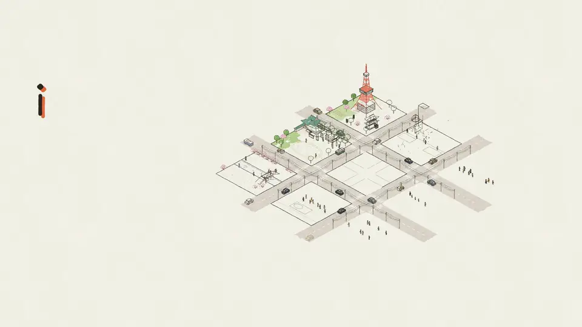</a>
</p>

<h1 align="center">inkcity Atlas</h1>

<p align="center">
  <b>Twelve cities, drawn alive.</b><br>
  Hand-inked isometric maps, built entirely in code. Each one draws itself, then lives:<br>
  traffic on a timetable, crowds that gather and scatter, and one clever moment only that city could have.<br>
  Press <code>N</code> and the city turns to night.
</p>

<p align="center">
  <a href="https://leehongji.github.io/inkcity-atlas/"></a>
  <a href="https://leehongji.github.io/inkcity-atlas/media/inkcity-atlas-film.mp4"></a>
  <a href="https://leehongji.github.io/inkcity-atlas/cities/tokyo/index.html?night"></a>
  <a href="#draw-your-own-city-the-inkcity-skill"></a>
  <a href="LICENSE"></a>
</p>

<p align="center">
  <a href="#the-twelve-cities">The cities</a> ·
  <a href="#by-day-and-by-night">Day and night</a> ·
  <a href="#see-it">See it</a> ·
  <a href="#draw-your-own-city-the-inkcity-skill">The skill</a> ·
  <a href="#the-film">The film</a> ·
  <a href="#what-is-here">What is here</a> ·
  <a href="#credits-and-licences">Credits</a>
</p>

---

Open a city and it draws itself: the pen scaffold first, then broken colour, then the people. Then it is yours to
explore: drag, zoom, click a place. Handwritten notes sit in the margins, and a guidebook tells each place's history
and the life you can see in it, with details to find. Every map is a single offline HTML page.

## By day and by night

<p align="center">
  <a href="https://leehongji.github.io/inkcity-atlas/cities/tokyo/index.html?night">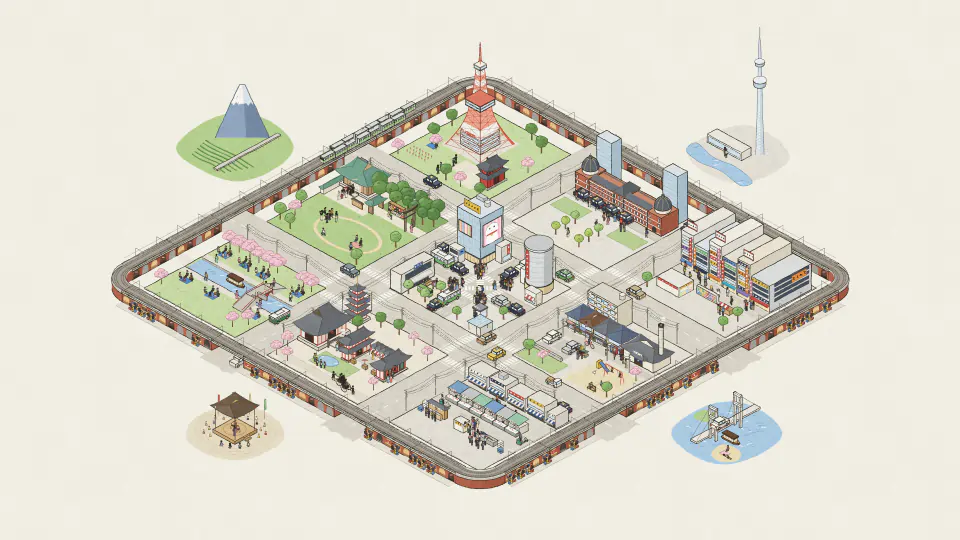</a>
</p>

Press `N`, or the night switch under the map, and the city turns to night. It is the same drawing under moonlight,
with each place lit the way it is lit today. Windows light up, every lamp lays a pool of light on the street, signs
and lanterns keep their colours, the landmarks are floodlit, and lights by the water are doubled in it. Motes drift up
out of the trees and the flower beds. Add `?night` to a city's address to open it at night; click one below.

| | | |
|---|---|---|
| [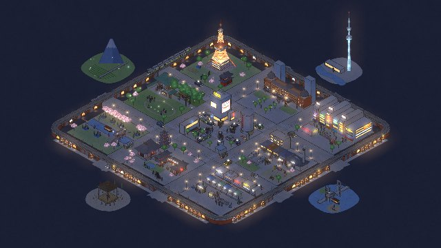](https://leehongji.github.io/inkcity-atlas/cities/tokyo/index.html?night) **Tokyo** | [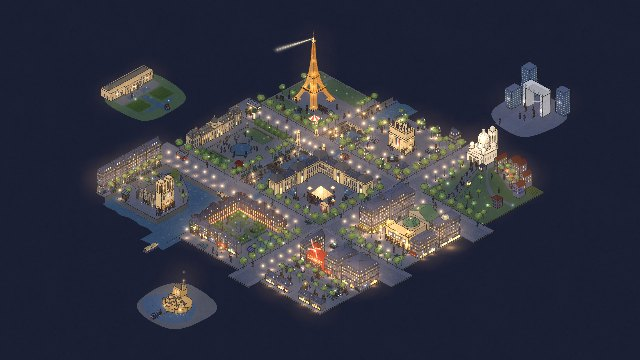](https://leehongji.github.io/inkcity-atlas/cities/paris/index.html?night) **Paris** | [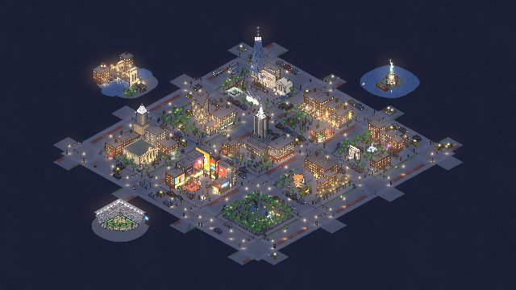](https://leehongji.github.io/inkcity-atlas/cities/newyork/index.html?night) **New York** |
| [](https://leehongji.github.io/inkcity-atlas/cities/london/index.html?night) **London** | [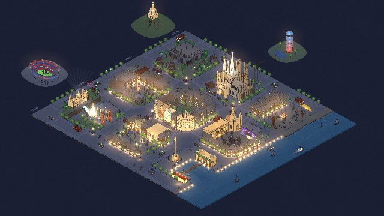](https://leehongji.github.io/inkcity-atlas/cities/barcelona/index.html?night) **Barcelona** | [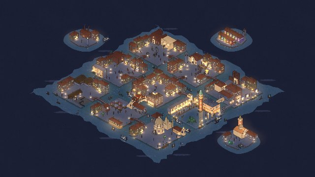](https://leehongji.github.io/inkcity-atlas/cities/venice/index.html?night) **Venice** |
| [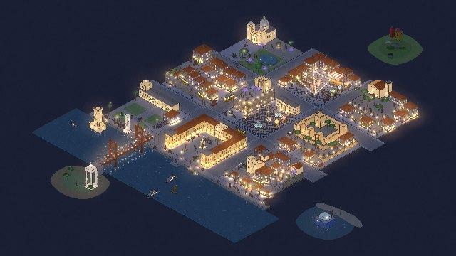](https://leehongji.github.io/inkcity-atlas/cities/lisbon/index.html?night) **Lisbon** | [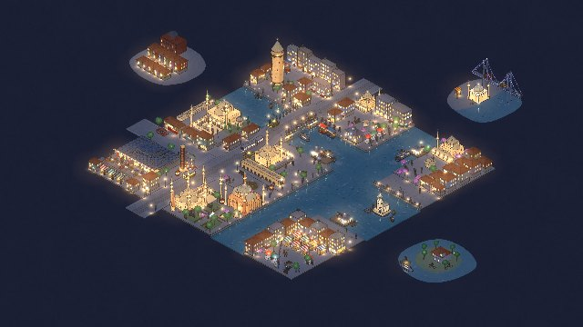](https://leehongji.github.io/inkcity-atlas/cities/istanbul/index.html?night) **Istanbul** | [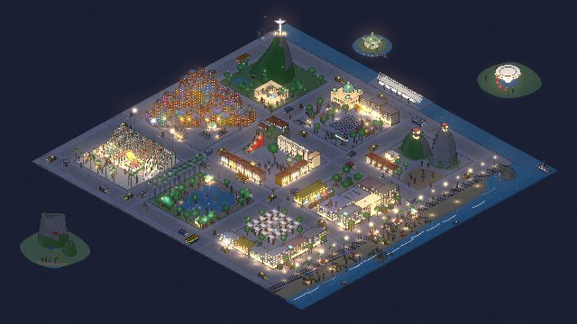](https://leehongji.github.io/inkcity-atlas/cities/rio/index.html?night) **Rio de Janeiro** |
| [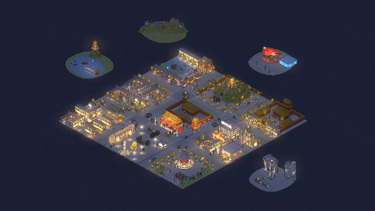](https://leehongji.github.io/inkcity-atlas/cities/beijing/index.html?night) **Beijing** | [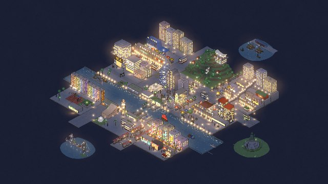](https://leehongji.github.io/inkcity-atlas/cities/hongkong/index.html?night) **Hong Kong** | [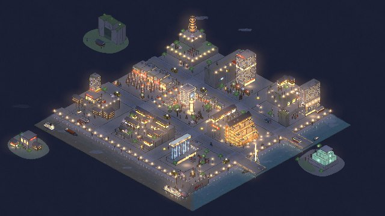](https://leehongji.github.io/inkcity-atlas/cities/chongqing/index.html?night) **Chongqing** |

## The twelve cities

Click a city to open it.

| | | |
|---|---|---|
| [](https://leehongji.github.io/inkcity-atlas/cities/tokyo/index.html) **Tokyo** 東京 | [](https://leehongji.github.io/inkcity-atlas/cities/paris/index.html) **Paris** | [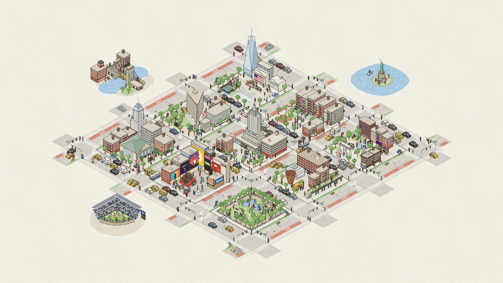](https://leehongji.github.io/inkcity-atlas/cities/newyork/index.html) **New York** |
| [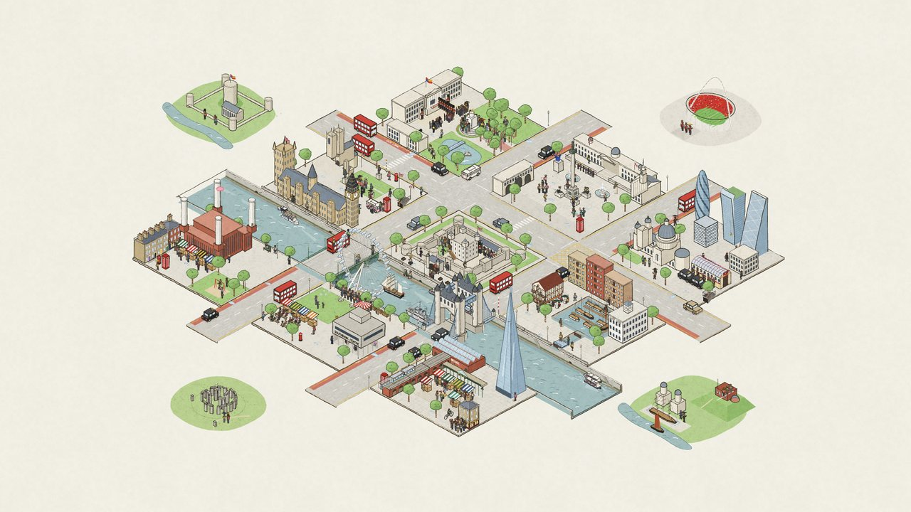](https://leehongji.github.io/inkcity-atlas/cities/london/index.html) **London** | [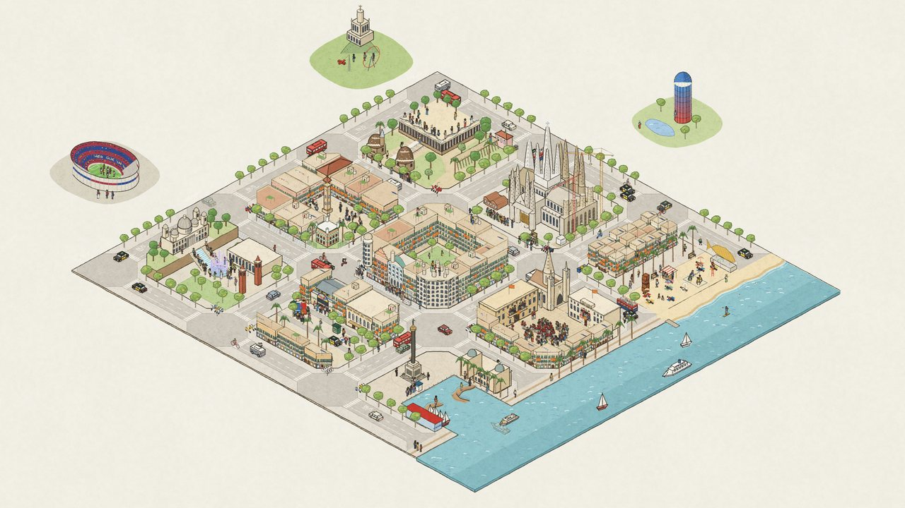](https://leehongji.github.io/inkcity-atlas/cities/barcelona/index.html) **Barcelona** | [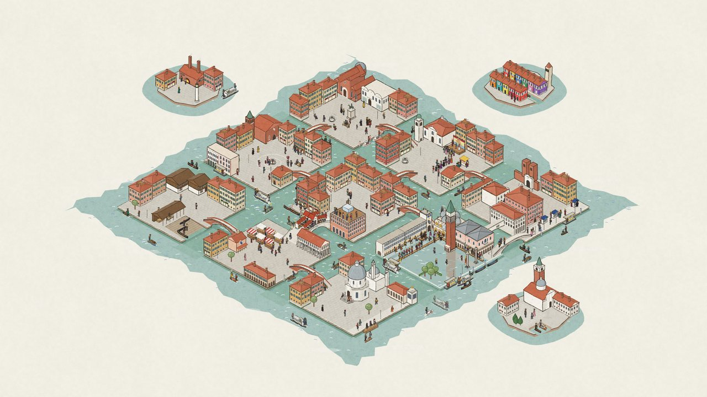](https://leehongji.github.io/inkcity-atlas/cities/venice/index.html) **Venice** |
| [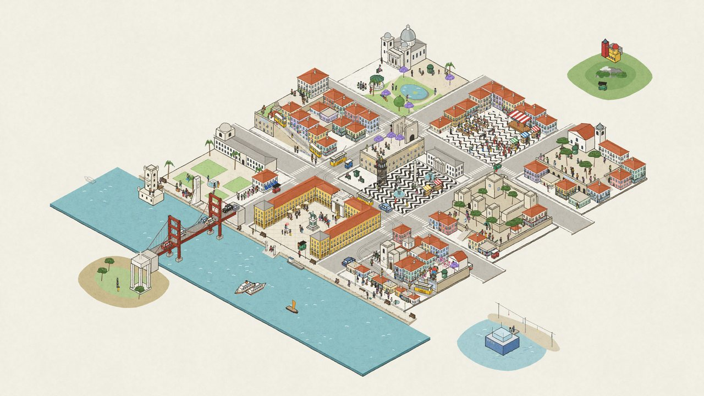](https://leehongji.github.io/inkcity-atlas/cities/lisbon/index.html) **Lisbon** | [](https://leehongji.github.io/inkcity-atlas/cities/istanbul/index.html) **Istanbul** | [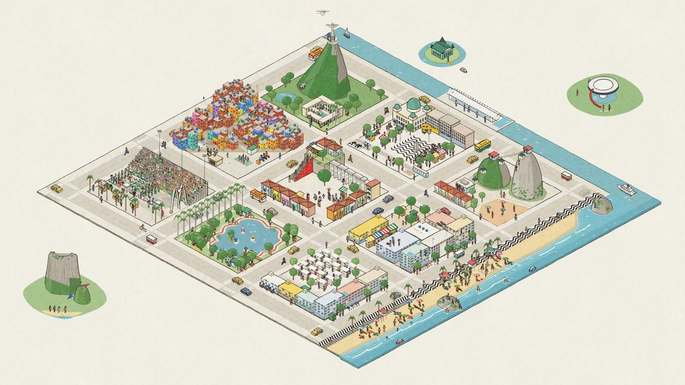](https://leehongji.github.io/inkcity-atlas/cities/rio/index.html) **Rio de Janeiro** |
| [](https://leehongji.github.io/inkcity-atlas/cities/beijing/index.html) **Beijing** 北京 | [](https://leehongji.github.io/inkcity-atlas/cities/hongkong/index.html) **Hong Kong** 香港 | [](https://leehongji.github.io/inkcity-atlas/cities/chongqing/index.html) **Chongqing** 重庆 |

| City | Street fingerprint | The moment | After dark |
|---|---|---|---|
| Tokyo | The Yamanote loop on its brick viaduct, trains circling, izakaya in the arches | Every light turns red and the whole crowd crosses at once at Shibuya | Tokyo Tower lit orange, the Skytree pale blue, night cherry blossom under paper lanterns |
| Paris | The Seine and its quais, Haussmann limestone, café terraces | Twelve cars pour into the Étoile, weave round the Arc and never touch | The Eiffel Tower golden, sparkling, its beacon turning; the Seine's bridges doubled in the river |
| New York | The one-way grid, yellow cabs, bus lanes, fire escapes | The lights on Fifth turn green block by block ahead of a pack of cabs | Times Square's screens, the brightest place on the map; the Empire State Building's white top |
| London | The Thames between embankments, red buses keeping left | Tower Bridge lifts for a tall ship while the traffic queues | Big Ben's lit dials, the Eye in pink, Tower Bridge traced in light |
| Barcelona | The Eixample grid, every corner cut into an octagonal plaza | Castellers build a human tower in Plaça Sant Jaume | The Sagrada Família floodlit; the Magic Fountain in its light show |
| Venice | No cars: canals for streets, gondolas, vaporetti, barges | Acqua alta floods San Marco; the walkways fill in single file | San Marco floodlit, every canal lamp doubled in the water, Carnival lanterns |
| Lisbon | Hills of tiled houses, wave-patterned squares, tram 28 | Two trams squeeze past each other on the Alfama's single track | The Santo António street party under strings of lights, sardine grills glowing |
| Istanbul | The Golden Horn and the Bosphorus, ferries, domes, cats | Anglers cast in a wave along the Galata Bridge as a ferry slides beneath | The mosques floodlit gold, ferries' lights on the Golden Horn, the Maiden's Tower |
| Rio de Janeiro | Sea, granite peaks, the Copacabana wave pavement | A samba school parades through the Sambadrome | Christ the Redeemer floodlit; the Sambadrome under its floodlights all night |
| Beijing | Hutong courtyards under golden ginkgo, the imperial axis | The flag guard marches out and Chang'an Avenue stops for it | Tiananmen floodlit, red lanterns down Qianmen and the hutongs, the ginkgos glowing gold |
| Hong Kong | Towers and neon on a harbour, trams keeping left | One Star Ferry berths at Central as the other casts off | Both shores of the harbour lit, Mong Kok's neon, December's Christmas lights |
| Chongqing | A city stacked on mountains where two rivers meet | The monorail runs straight through a residential tower | Hongyadong lit gold from top to bottom, the monorail lit through its tower |

## See it

Online: **https://leehongji.github.io/inkcity-atlas/**. Offline: open `index.html` in a browser. It works straight from disk, and so does every city. Or serve the folder:

```sh
python3 -m http.server 8000      # then open http://localhost:8000
```

Keys in a city: `1`–`9` jump to places, `0` or `Esc` frames the whole city, `N` switches day and night, `Space` pauses,
`R` plays the guided tour.

## Draw your own city: the inkcity skill

`skill/inkcity/` is a skill for [Claude Code](https://claude.com/claude-code). Give it a place, real or invented, and
it builds one offline page like these: the places draw themselves, a camera tours them, and the map is then yours
to explore. Every frame is a pure function of its number, so a page can also be recorded frame-exactly to video.

```sh
cp -r skill/inkcity ~/.claude/skills/
```

Then ask, in any words: *"Draw my home town as a living hand-inked map."* The skill brings an engine, a starter town
that already plays, scripts to check every frame and every pan (`verify`, `perf`, `explore`, `interact`), references
on depth order, drawing and pitfalls, and worked examples. Start with `skill/inkcity/SKILL.md`. Its maps have a
night too: a moonlit grade, lit windows and lamps, halos, glints, reflections and drifting motes, and a few calls to say
what lights up in your place (`references/engine.md`, §9c).

The scripts need Node 18+ and Playwright, and Python 3 for building pages:

```sh
npm i -D playwright                                   # or set PLAYWRIGHT_FROM=<a folder with node_modules/playwright>
cd cities/tokyo
python3 ../../skill/inkcity/scripts/build.py dev.html index.html
node ../../skill/inkcity/scripts/verify.mjs index.html
```

## The film

[**Watch it (43 s, 1080p)**](https://leehongji.github.io/inkcity-atlas/media/inkcity-atlas-film.mp4): a city draws itself, six cities show their moment,
the Beijing guidebook leads into a hutong courtyard, twelve Polaroids land on the desk, and a sentence becomes a town.

There are no screen recordings. Every frame is drawn by the real pages:
- **City shots:** in `?f=0` mode a city draws any film frame at any camera through `SF.seek(n, cam)`.
- **The guidebook:** the real Beijing page and overlay, clicked by a script on a controlled clock.
- **The desk and lettering:** the gallery's own Looseleaf components.
- **Sound:** the score and the pen, paper and desk sounds are original, made in code.

The source, the shot list and the rebuild steps are in [`film/`](film/).

## What is here

```
index.html, gallery/      the gallery page (built from gallery-src/)
thumbs/                   the gallery's photos of each city
cities/<slug>/            one city
  index.html              the built page: one self-contained file
  dev.html                the same page loading the sources below (for editing)
  src/35_scene.js         the film: shots, timing, the explore bounds
  src/36_<slug>.js        the city's own kit: its people, vehicles, roofs, signs
  src/tiles/*.js          one file per district, the streets, the satellites
  src/guide.js            the guidebook's words: notes, places, stories, things to find
  brief.md, refs/         the plan and the landmark data cards behind the drawing
  tools/                  timetable searches and checks for that city's traffic
cities/BRIEF-*.md         the briefs every city follows (drawing, writing its guide, lighting it at night)
cities/tools/             night-check (the day stays pixel-identical; the night views) and the README's night media
engine/                   the shared engine: projection, pen, kit, world, render, app
skill/inkcity/            the skill that makes all of this (see below)
gallery-src/              the gallery and guide overlay source (React, Vite, Tailwind, Looseleaf)
film/                     the promo film: direction, shots, capture tools, score (see film/README.md)
media/                    the film, as served by the site
docs/media/               the README's preview, poster, day-to-night animation and night thumbnails
```

## Rebuilding the gallery

```sh
cd gallery-src
npm install
npm run publish        # builds ../index.html, ../gallery/ (with guide.js) and the skill download
```

## Credits and licences

- Code, cities, engine and skill: MIT, see `LICENSE`.
- `film/` is built on the starter project of [guizang-product-video-skill](https://github.com/op7418/guizang-product-video-skill)
  (© op7418, GNU AGPL-3.0): that folder keeps its own licence, see `film/LICENSE` and `film/NOTICE.md`. The film's
  music and sound effects are original to this project; the click and typing sounds come from that skill.
- The gallery and the guide are set with [Looseleaf](https://kevintngo.github.io/looseleaf/) components and the
  Kevin Sans typeface by Kevin T. Ngo (MIT, `licenses/Looseleaf-and-Kevin-Sans.txt`). The copy of Kevin Sans here adds
  a few accented letters (ā ē ī ō ū ğ ş İ Ç Ş Ğ) built from the font's own glyphs.
- IBM Plex Mono: SIL Open Font License 1.1 (`licenses/IBM-Plex-Mono-OFL.txt`).
- Landmark proportions were read from [Wikidata](https://www.wikidata.org/) (CC0) and
  [OpenStreetMap](https://www.openstreetmap.org/copyright) (© OpenStreetMap contributors, ODbL); the cards are in each
  city's `refs/`. Landmarks are drawn from that data, compressed and sometimes turned to face the viewer.
- The hand-inked, self-drawing map owes its spark to Kevin T. Ngo's hand-drawn San Francisco.
