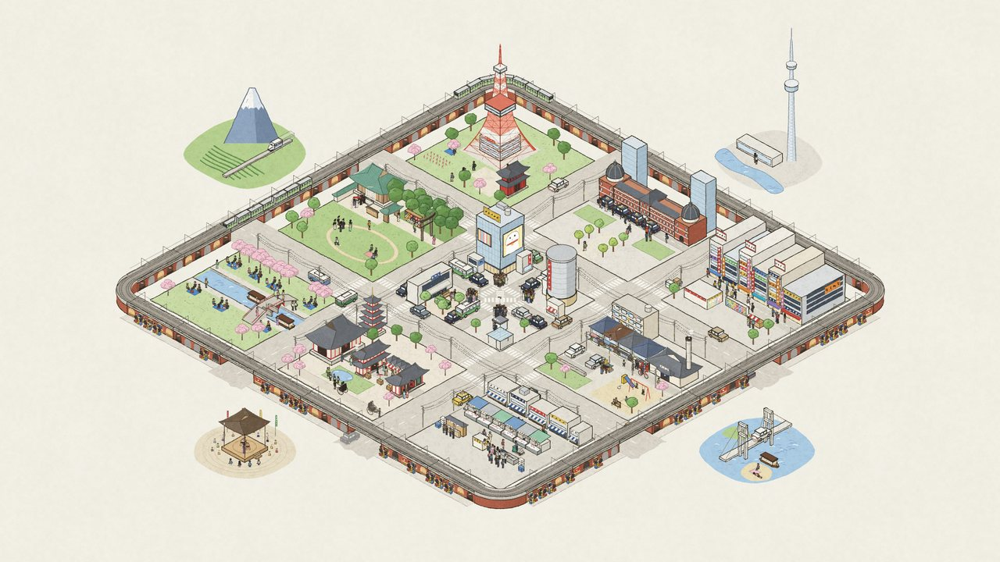
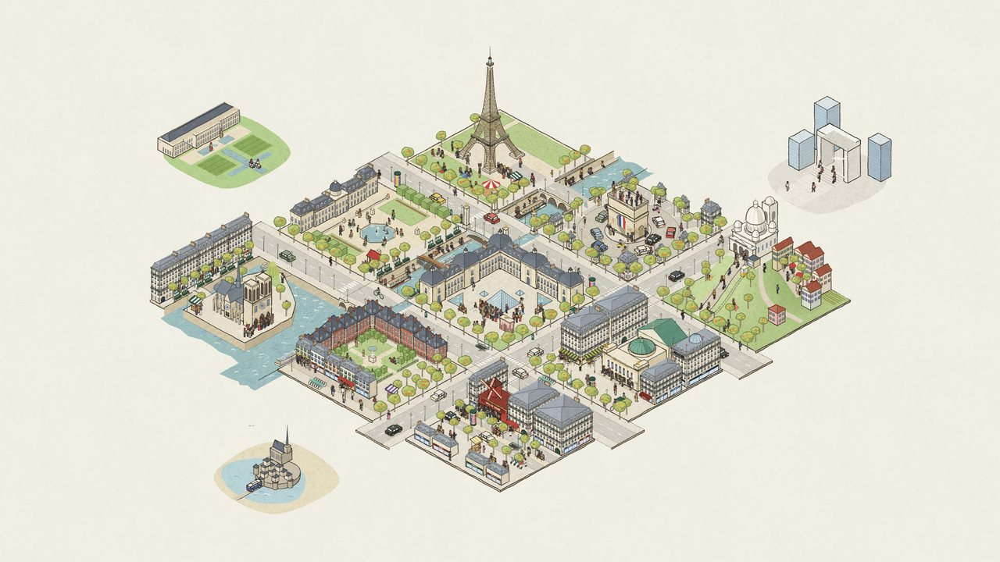
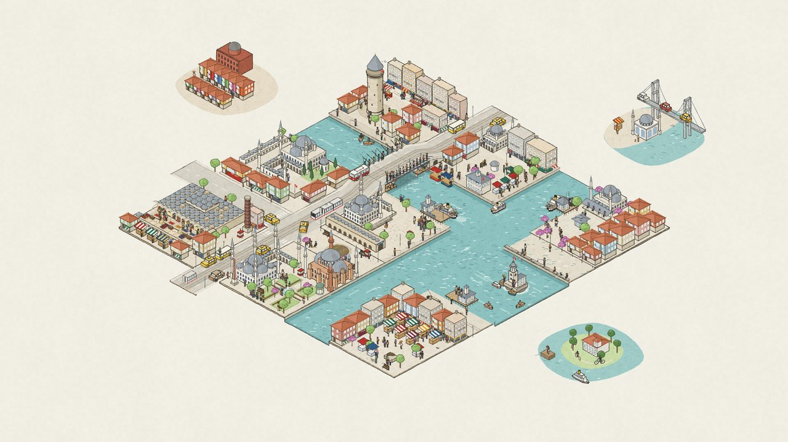
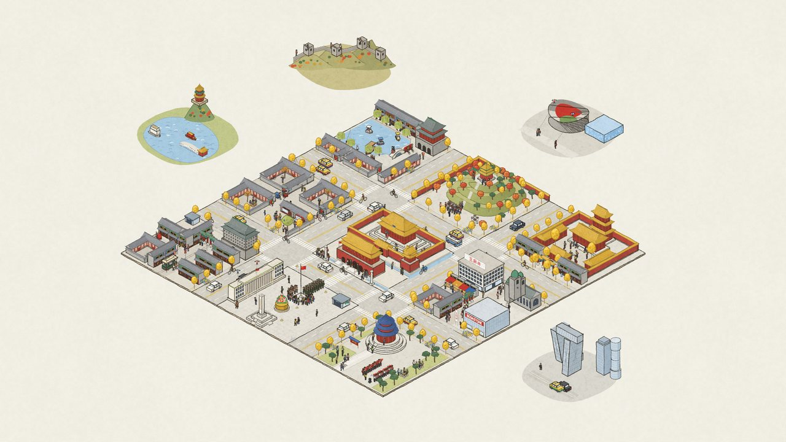
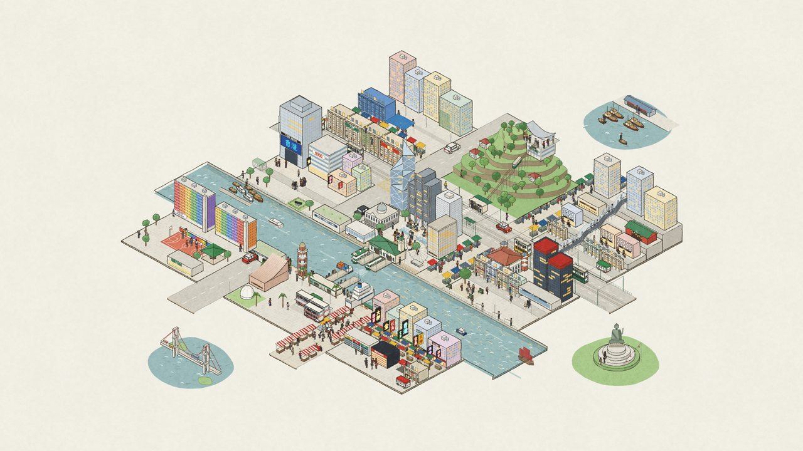
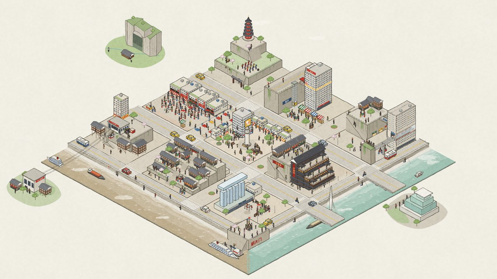

# inkcity Atlas

**Twelve cities, drawn alive.** Each city is a hand-inked isometric map built entirely in code: its districts stitched
together on one ground, full of small lives (traffic on a timetable, crowds that gather and scatter, boats, trams,
a wedding, a game) and one clever moment that only that city could have. Every map is a single offline HTML page.

Open a city and it draws itself: the pen scaffold first, then broken colour, then the people. Then it is yours to
explore: drag, zoom, click a place. Handwritten notes sit in the margins, and a guidebook tells each place's history
and the life you can see in it, with details to find.

| | | |
|---|---|---|
|  **Tokyo** 東京 |  **Paris** |  **New York** |
|  **London** |  **Barcelona** |  **Venice** |
|  **Lisbon** |  **Istanbul** |  **Rio de Janeiro** |
|  **Beijing** 北京 |  **Hong Kong** 香港 |  **Chongqing** 重庆 |

## See it

Open `index.html` in a browser. It works straight from disk, and so does every city. Or serve the folder:

```sh
python3 -m http.server 8000      # then open http://localhost:8000
```

Keys in a city: `1`–`9` jump to places, `0` or `Esc` frames the whole city, `Space` pauses, `R` plays the guided tour.

## The cities

| City | Street fingerprint | The moment |
|---|---|---|
| Tokyo | The Yamanote loop on its brick viaduct, trains circling, izakaya in the arches | Every light turns red and the whole crowd crosses at once at Shibuya |
| Paris | The Seine and its quais, Haussmann limestone, café terraces | Twelve cars pour into the Étoile, weave round the Arc and never touch |
| New York | The one-way grid, yellow cabs, bus lanes, fire escapes | The lights on Fifth turn green block by block ahead of a pack of cabs |
| London | The Thames between embankments, red buses keeping left | Tower Bridge lifts for a tall ship while the traffic queues |
| Barcelona | The Eixample grid, every corner cut into an octagonal plaza | Castellers build a human tower in Plaça Sant Jaume |
| Venice | No cars: canals for streets, gondolas, vaporetti, barges | Acqua alta floods San Marco; the walkways fill in single file |
| Lisbon | Hills of tiled houses, wave-patterned squares, tram 28 | Two trams squeeze past each other on the Alfama's single track |
| Istanbul | The Golden Horn and the Bosphorus, ferries, domes, cats | Anglers cast in a wave along the Galata Bridge as a ferry slides beneath |
| Rio de Janeiro | Sea, granite peaks, the Copacabana wave pavement | A samba school parades through the Sambadrome |
| Beijing | Hutong courtyards under golden ginkgo, the imperial axis | The flag guard marches out and Chang'an Avenue stops for it |
| Hong Kong | Towers and neon on a harbour, trams keeping left | One Star Ferry berths at Central as the other casts off |
| Chongqing | A city stacked on mountains where two rivers meet | The monorail runs straight through a residential tower |

## What is here

```
index.html, gallery/      the gallery page (built from gallery-src/)
thumbs/                   the gallery's photos of each city
cities/<slug>/            one city
  index.html              the built page: one self-contained file
  dev.html                the same page loading the sources below (for editing)
  src/35_scene.js         the film: shots, timing, the explore bounds
  src/36_<slug>.js        the city's own kit: its people, vehicles, roofs, signs
  src/tiles/*.js          one file per district, the streets, the satellites
  src/guide.js            the guidebook's words: notes, places, stories, things to find
  brief.md, refs/         the plan and the landmark data cards behind the drawing
  tools/                  timetable searches and checks for that city's traffic
cities/BRIEF-*.md         the briefs every city follows (drawing, and writing its guide)
engine/                   the shared engine: projection, pen, kit, world, render, app
skill/inkcity/            the skill that makes all of this (see below)
gallery-src/              the gallery and guide overlay source (React, Vite, Tailwind, Looseleaf)
```

## Draw your own city: the inkcity skill

`skill/inkcity/` is a skill for [Claude Code](https://claude.com/claude-code). Give it a place, real or invented, and
it builds one offline page like these: the places draw themselves, a camera tours them, and the map is then yours
to explore. Every frame is a pure function of its number, so a page can also be recorded frame-exactly to video.

```sh
cp -r skill/inkcity ~/.claude/skills/
```

Then ask, in any words: *"Draw my home town as a living hand-inked map."* The skill brings an engine, a starter town
that already plays, scripts to check every frame and every pan (`verify`, `perf`, `explore`, `interact`), references
on depth order, drawing and pitfalls, and worked examples. Start with `skill/inkcity/SKILL.md`.

The scripts need Node 18+ and Playwright, and Python 3 for building pages:

```sh
npm i -D playwright                                   # or set PLAYWRIGHT_FROM=<a folder with node_modules/playwright>
cd cities/tokyo
python3 ../../skill/inkcity/scripts/build.py dev.html index.html
node ../../skill/inkcity/scripts/verify.mjs index.html
```

## Rebuilding the gallery

```sh
cd gallery-src
npm install
npm run publish        # builds ../index.html, ../gallery/ (with guide.js) and the skill download
```

## Credits and licences

- Code, cities, engine and skill: MIT, see `LICENSE`.
- The gallery and the guide are set with [Looseleaf](https://kevintngo.github.io/looseleaf/) components and the
  Kevin Sans typeface by Kevin T. Ngo (MIT, `licenses/Looseleaf-and-Kevin-Sans.txt`). The copy of Kevin Sans here adds
  a few accented letters (ā ē ī ō ū ğ ş İ Ç Ş Ğ) built from the font's own glyphs.
- IBM Plex Mono: SIL Open Font License 1.1 (`licenses/IBM-Plex-Mono-OFL.txt`).
- Landmark proportions were read from [Wikidata](https://www.wikidata.org/) (CC0) and
  [OpenStreetMap](https://www.openstreetmap.org/copyright) (© OpenStreetMap contributors, ODbL); the cards are in each
  city's `refs/`. Landmarks are drawn from that data, compressed and sometimes turned to face the viewer.
- The hand-inked, self-drawing map owes its spark to Kevin T. Ngo's hand-drawn San Francisco.
